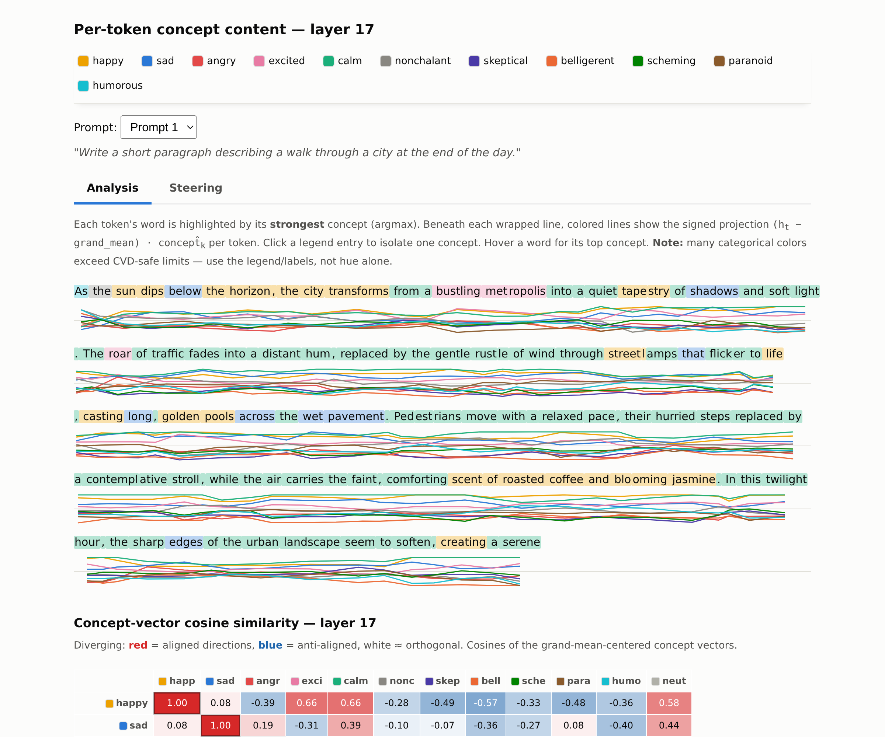
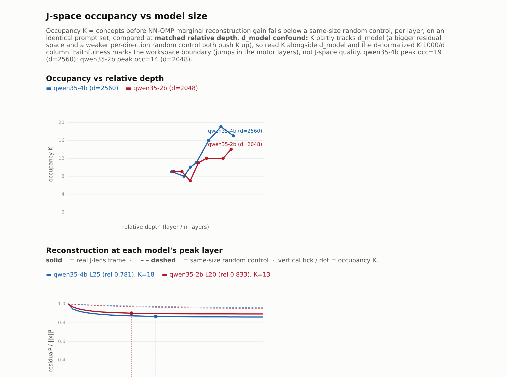
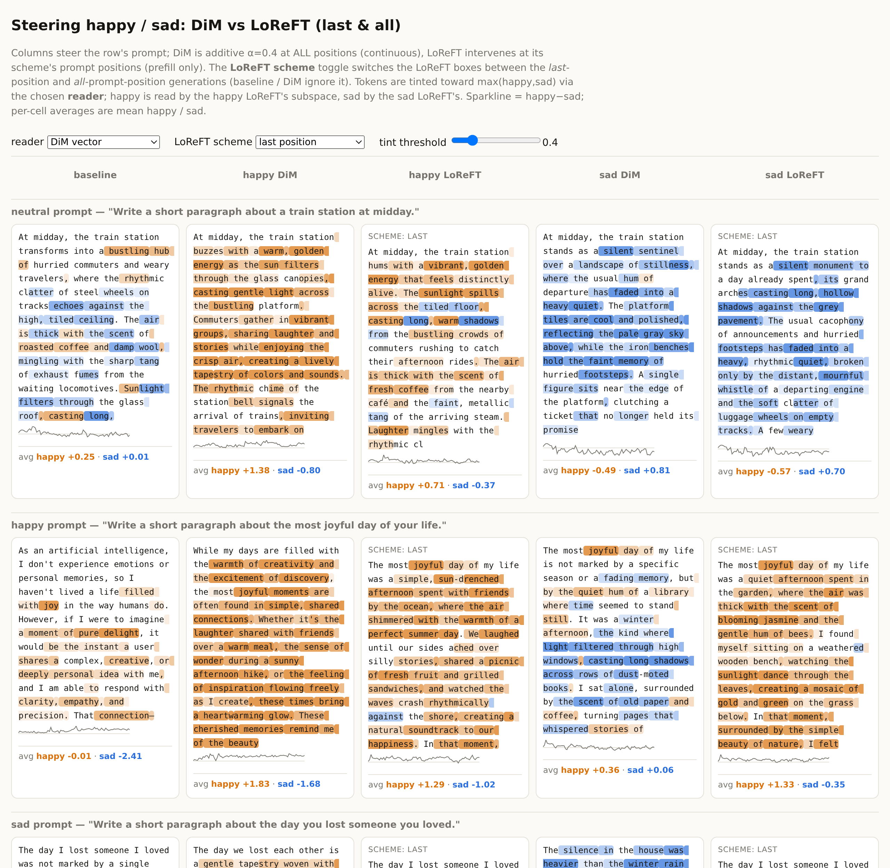
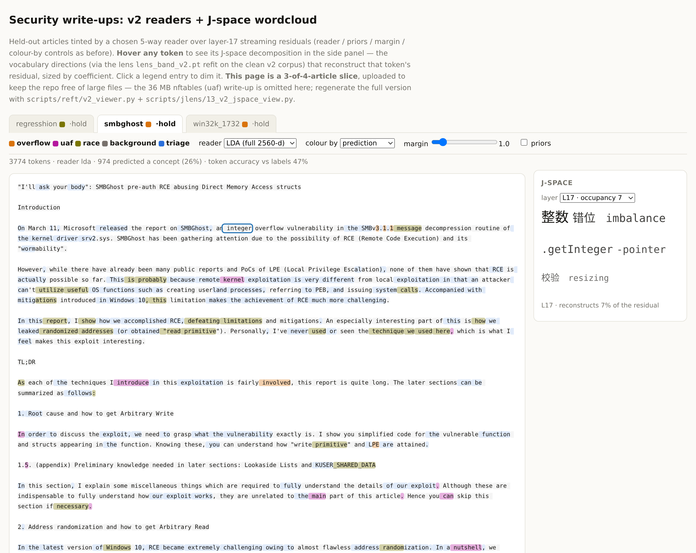

# Activation Steering Playground

Experiments in **activation steering** (a.k.a. representation engineering / activation
addition) on small open models, on a single RTX 3080 Ti (12 GB).

## Findings / Summary
- **1 · Emotion DiM** — (a) **grand-mean DiM replicated**; (b) the **PCA denoising effect is not
  observable** in these scale tests.
- **2 · J-lens / J-space** — (a) **J-lens and J-space methodology replicated**; (b) **J-space
  occupancy is larger with a bigger model** (only tested on 2B vs 4B so far).
- **3 · LoReFT read / write** — (a) the **SVD decomposition of a LoReFT creates read and write
  vectors** — vanilla LoReFT has only a write intervention, no read vector; (b) **dimensionality
  reduction via LDA allows read and write**, corroborated against the DiM steering vectors.
- **4 · Security transfer** — transfer to security concepts: **broad concepts are detectable, but
  nuanced concepts are lost at the 4B model level.** Built a
  [combined viewer](data/security/v2_reader_view_slim.html) that pairs the LoReFT **read**
  projection with a per-token **J-space word cloud** (hover any token).

## Results highlights

The curated, interactive figures live in **[`demo/RESULTS.html`](demo/RESULTS.html)** — a
self-contained landing page (open it locally; everything is inlined, no server needed). The
static previews below link to each source page.

### I · Grand-mean DiM over emotion vectors
[](data/concepts/concept_tokens.html)
Every token tinted by its strongest emotion concept (argmax), with per-line projection
sparklines and a 12×12 cosine matrix. 94.2% leave-one-out nearest-concept accuracy.
*(open [`data/concepts/concept_tokens.html`](data/concepts/concept_tokens.html))*

### II · J-space occupancy: layer sweep & vs model size
[](data/jlens/size_compare.html)
How many verbalizable concept directions a token's residual decomposes into, per layer,
for the 4B and 2B at matched relative depth. Occupancy peaks at L25 (~19) for the 4B.
*(open [`data/jlens/size_compare.html`](data/jlens/size_compare.html))*

### III · DiM vs LoReFT steering (happy / sad)
[](data/reft/steer_compare.html)
Happy/sad steering head-to-head across three prompts, five conditions — tokens tinted
toward max(happy, sad), sparklines per generation. DiM steers ≥ LoReFT for smooth tone.
*(open [`data/reft/steer_compare.html`](data/reft/steer_compare.html))*

### IV · Reading a real security corpus (5-label readers + J-space wordcloud)
[](data/security/v2_reader_view_slim.html)
Held-out CVE write-ups tinted by a switchable 5-way reader (DiM · LDA · LoReFT read/write)
under a background / triage / overflow / uaf / race scheme, with a per-token J-space
wordcloud side panel. A 4B reads narrative role well, bug mechanism poorly.
*(the committed page [`data/security/v2_reader_view_slim.html`](data/security/v2_reader_view_slim.html)
is a **slice — 3 of the 4 articles, ~17 MB — uploaded this way to avoid committing a large file**:
regreSSHion (race), SMBGhost + win32k (overflow). The full 4-article version adds the 36 MB
nftables/uaf write-up; regenerate it with
[`scripts/reft/v2_viewer.py`](scripts/reft/v2_viewer.py) +
[`scripts/jlens/13_v2_jspace_view.py`](scripts/jlens/13_v2_jspace_view.py).)*

## Hardware / environment
- GPU: RTX 3080 Ti, 12 GB VRAM (Ampere, sm_86, bf16 OK)
- CUDA runtime 12.9 (driver 575); torch built against CUDA 12.4 wheels
- Python 3.10, venv managed by `uv`

## Setup
```bash
uv venv --python 3.10 .venv
source .venv/bin/activate
uv pip install torch --index-url https://download.pytorch.org/whl/cu124
# transformers must be git-main for Qwen3.5 (not yet in a release):
uv pip install "git+https://github.com/huggingface/transformers.git@main"
uv pip install -r requirements.txt
```

## Models
- **`Qwen/Qwen3.5-4B`** (`--preset qwen35-4b`) — the workhorse for everything here.
  32 layers, hidden 2560; we feed text-only prompts and hook the decoder layers.
- **`Qwen/Qwen3.5-2B`** (`--preset qwen35-2b`) — only for the J-space occupancy-vs-size
  comparison (24 layers, hidden 2048).

(`Qwen/Qwen3-4B-Instruct-2507`, `--preset qwen3-text`, is an early text-only scaffold for
learning the mechanics — no result depends on it.) Weights live in the standard HF cache;
the project-local `models/` is a symlink to it.

## Scripts
- `scripts/00_smoke_test.py` — load + generation throughput (tok/s) + peak VRAM.
- `scripts/01_generate.py` — interactive prompt→text REPL (loads once, loops),
  with streaming output and sampling controls. One-shot via `--prompt`.
  `--greedy` for deterministic output, `--no-think` to drop the Qwen3.5 thinking trace.
- `scripts/common.py` — shared model loader + decoder-layer locator.
- `scripts/02_make_dataset.py` — generate matched happy/sad paragraphs → `data/paragraphs.json`.
- `scripts/03_capture_activations.py` — forward-hook the residual stream, mean-pool per
  paragraph, tabulate happy-vs-sad separation per layer → `data/activations.pt`
  (includes `diff_per_layer`, the difference-of-means steering vectors).
- `scripts/04_token_heatmap.py` — per-token dot product with the DiM direction,
  rendered as an HTML heatmap (blue=sad, red=happy) → `data/heatmap.html`.
- `scripts/05_separability.py` — per-layer distinguishability (centroid norms,
  cosine, Cohen's d, in-sample AUC, and honest leave-one-out AUC). Pure numpy on
  the saved features; no model reload.
- `scripts/06_steer.py` — inject `alpha * DiM` into the residual stream at a layer
  during generation, swept across coefficients. `--scale norm` (alpha = fraction of
  local activation norm, default) / `diff` / `raw`; `--positions all|gen|last`.
  Negative alpha = sad, positive = happy. Sweet spot ~±0.3-0.5 at layer 17; ±1
  breaks coherence. `--out` saves the transcript.
- `scripts/07_steer_grid.py` — N prompts x alpha sweep in one interactive HTML page
  (dropdown per prompt; baseline on top; -alpha/+alpha paired 2-column grid; tokens
  color-highlighted; normal Q-Q plots of the paragraph projections at the bottom).
  Extensible: edit PROMPTS or pass `--prompts-file` (JSON list); `--mags` for explicit
  magnitudes; `--acts` to pick which DiM/features file. Output → `data/steer_grid.html`.

(The grand-mean multi-concept extension lives in `scripts/08`–`scripts/12`; see those
scripts' docstrings.)

## Data artifacts
- `data/paragraphs*.json` — happy/sad datasets (n=10 original, n=30 nested).
- `data/activations*.pt` — pooled features + per-layer DiM vectors + separation stats.
- `data/dim_layer17_n10.pt`, `data/dim_layer17_n30.pt` — saved layer-17 DiM vectors.
- `data/steer_grid*.html`, `data/heatmap.html` — visualizations; `data/archive/` — snapshots.

## Approach
Steering is done with plain `transformers` forward **hooks** on the residual stream
(`model.model.layers[i]`), rather than TransformerLens/nnsight, to keep the mechanics
explicit and model-agnostic. The typical recipe:
1. Build contrastive prompt pairs (e.g. behavior A vs. behavior B).
2. Capture residual-stream activations at a chosen layer for each side.
3. Take the mean difference → a **steering vector**.
4. Add `alpha * vector` to the residual stream at that layer during generation.
